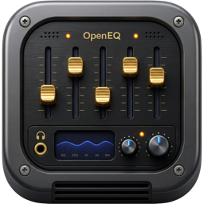

  

<h1 align="center">OpenEQ</h1>

A precise equalizer for your Mac. Free.

  <a href="https://github.com/oznksc/OpenEQ/releases/latest"><b>Download the latest release</b></a>

---

OpenEQ is a free audio equalizer for macOS. Open a track, shape it, and compare honestly, or use the experimental system-wide mode to process audio from other apps. No account, no ads, no tracking.

## Features

- **Graphic & parametric EQ:** 10- and 31-band graphic EQ, or a 5-band parametric EQ with an interactive curve
- **Layered EQ:** Calibration → Target Curve → Session Tuning
- **Level-matched A/B:** automatic loudness matching with click-free crossfades, undo/redo and A/B/C snapshots
- **Metering:** true-peak (dBTP), RMS, headroom and peak hold, with Auto Headroom against clipping
- **Headphone library:** curated profiles, plus AutoEQ and REW calibration import
- **Live spectrum:** 64-band FFT in seven styles, optionally in the menu bar
- **Comfort Guard:** local-only listening-load guidance with optional, reversible treble relief
- **Menu bar, Dock or both:** control System Audio, bypass and presets without opening the main window
- **AUv3 & dynamics:** Audio Unit effects, compressor, stereo balance and an always-on peak limiter

## System-wide EQ (experimental)

System-Wide EQ processes audio from other apps using a Core Audio process tap, so no audio driver is installed. It requires macOS 14.2 or later and the **Screen & System Audio Recording** permission, which macOS asks for the first time you turn it on. Local file playback is the stable core; system-wide processing is still experimental.

Built-in safety includes feedback (howling) protection, a safe mode that restores your original output device, sleep/wake recovery and per-device presets.

## Install

1. Download the latest `OpenEQ-<version>.dmg` from [Releases](https://github.com/oznksc/OpenEQ/releases/latest).
2. Open the disk image and drag **OpenEQ** into **Applications**.
3. Launch OpenEQ from Applications.

Releases from 1.1.0 on are signed with Developer ID and notarized by Apple.

## Requirements

| | |
|---|---|
| Local EQ | macOS 14.0 or later |
| System-Wide EQ | macOS 14.2 or later |
| Processor | Apple silicon or Intel |

## Feedback

Found a bug or have an idea? [Open an issue](https://github.com/oznksc/OpenEQ/issues/new/choose). Please search existing issues first.

This repository hosts releases and issue tracking. The source code is not public.

## License

OpenEQ is free to use, including for commercial work. See [LICENSE.md](LICENSE.md).
